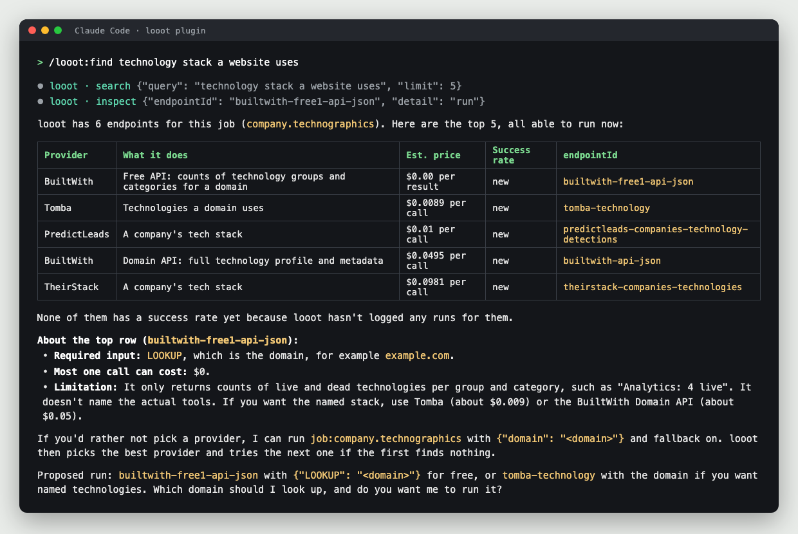
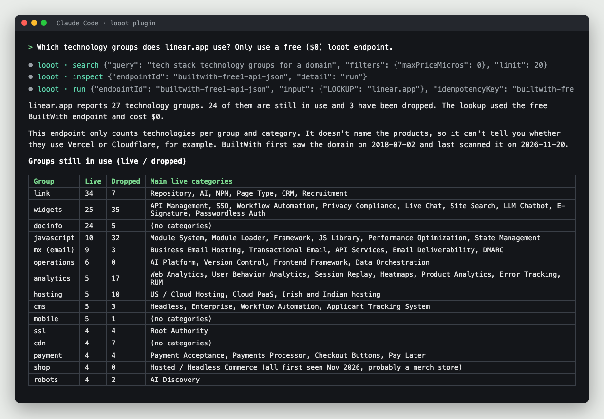

# looot for Claude


looot gives Claude one sign-in and one prepaid balance for thousands of data API endpoints from
hundreds of providers: work email and phone finding, email verification, company and people
enrichment, Google results, SEO and backlinks, social profiles and posts, web search and pages as
text, news, ads, maps and finance. Claude searches the catalog by job, shows the price and the
measured success rate before anything runs, then runs the endpoint you pick with automatic fallback
to the next provider. You pay per call, and a call that fails costs nothing.

## What is inside

| Part | What it does |
|---|---|
| looot MCP server | The remote server at `https://api.looot.ai/mcp` (Streamable HTTP). Tools: `search`, `inspect`, `run`, `balance`, `top_up`, `runs_get`, `runs_list` and a few more. Sign-in is OAuth in the browser. |
| `looot` skill | Loads by itself when a task needs outside data. Teaches the flow: search (free), inspect (free), run with fallback, read the outcome and cost, check the balance, top up. |
| `/looot:setup` | Walks you through sign-in, a free balance check and a first free search. |
| `/looot:find <job>` | Compares the endpoints that do a job by price, success rate and speed. Runs nothing. |
| `/looot:balance [amount]` | Shows your credit. With an amount, opens a Stripe top-up link for you to pay. |

There are no hooks, no scripts and no local programs. Nothing runs on your machine besides Claude.

## Install

In Claude Code:

```text
/plugin marketplace add loootai/looot-skills
/plugin install looot@looot-skills
```

Then sign in: type `/mcp`, pick the looot server, choose **Authenticate**, pick your workspace on
looot.ai and click **Connect**. Or run `/looot:setup` and Claude walks you through it.

No account yet? Sign up at https://looot.ai/auth/sign-up. A new account with a confirmed email gets
$2 of free credit, once. Searching the catalog, inspecting endpoints and reading your balance are
always free.

If you added looot by hand before (`claude mcp add looot ...`), remove that entry with
`claude mcp remove looot` so the tools do not load twice.

## Try it

- "Which tech stack does linear.app run?" (a free endpoint)
- "Find the work email of the head of marketing at stripe.com and verify it."
- "What does Google show for 'best crm' in the US?"
- `/looot:find backlinks for a domain`

## Screenshots

Both are real Claude Code sessions with this plugin, run on 2026-11-21.





## Data and privacy

- What leaves your machine: the tool calls Claude makes to `https://api.looot.ai/mcp`, which carry
  your search text and the inputs of each run (for example a name and a company domain). looot sends
  a run's input to the provider that answers it, under that provider's terms.
- What looot keeps: your account email and workspace, each run's input, output, status and cost, and
  billing records, so you can read past runs back and see every charge.
- Payments go through Stripe checkout pages you open yourself. The plugin never handles card details.
- The plugin holds no key or token. The OAuth token stays in Claude's own credential store.

Privacy policy: https://looot.ai/privacy. Terms: https://looot.ai/terms.

## Support

- Docs: https://docs.looot.ai/connect/claude-code
- Help: https://looot.ai/contact
- Source and issues: https://github.com/loootai/looot-skills

## License

MIT. See [LICENSE](LICENSE). The hosted looot service has its own terms: https://looot.ai/terms.
