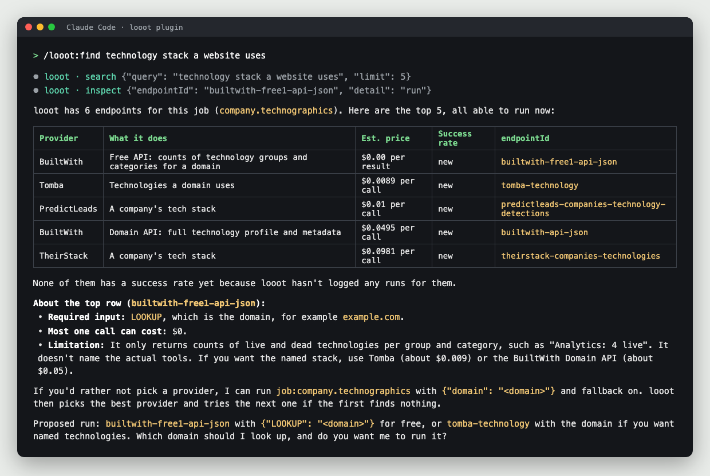
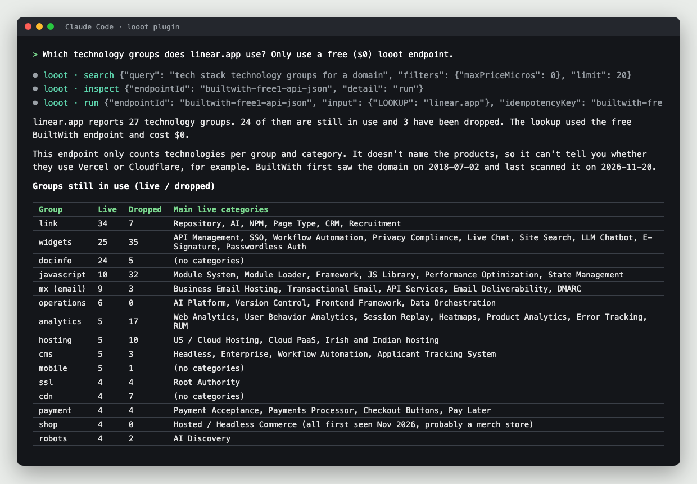

# looot for Codex


looot gives Codex one sign-in and one prepaid balance for thousands of data API endpoints from
hundreds of providers: work email and phone finding, email verification, company and people
enrichment, Google results, SEO and backlinks, social profiles and posts, web search and pages as
text, news, ads, maps and finance. Codex searches the catalog by job, shows the price and the
measured success rate before anything runs, then runs the endpoint you pick with fallback to the
next provider. You pay per call, and a call that fails costs nothing.

This folder is a plugin in the portable Agent Plugins format: `plugin.json` with the Codex listing
under `extensions.com.openai`, `mcp.json`, `skills/` and `assets/`.

## What is inside

| Part | What it does |
|---|---|
| looot MCP server | The remote server at `https://api.looot.ai/mcp` (Streamable HTTP). Tools: `search`, `inspect`, `run`, `balance`, `top_up`, `runs_get`, `runs_list` and a few more. Sign-in is OAuth in the browser. |
| `looot` skill | The flow: search (free), inspect (free), run with fallback, read the outcome and cost, check the balance, top up. |
| `setup` skill | Sign-in, a free balance check and a first free search, step by step. |
| `find` skill | Compares the endpoints that do a job by price, success rate and speed. Runs nothing. |
| `balance` skill | Shows your credit, and opens a Stripe top-up link when you ask for one. |

No hooks, no scripts, no local programs.

## Install

```bash
codex plugin marketplace add loootai/looot-skills
codex plugin add looot@looot-skills
codex mcp login looot
```

`codex mcp login looot` opens the browser: pick your workspace on looot.ai and click **Connect**.
Keep the command running until you approve. In the Codex app, open **Plugins**, find looot and
select **Install**, then connect when asked.

No account yet? Sign up at https://looot.ai/auth/sign-up. A new account with a confirmed email gets
$2 of free credit, once. Searching the catalog, inspecting endpoints and reading your balance are
always free.

## Try it

- "Which tech stack does linear.app run?" (a free endpoint)
- "Find the work email of the head of marketing at stripe.com."
- "What is my looot balance?"

## Screenshots

The same skills and server in a Claude Code session, run on 2026-11-21:





## Data and privacy

- What leaves your machine: the tool calls Codex makes to `https://api.looot.ai/mcp`, which carry your
  search text and the inputs of each run. looot sends a run's input to the provider that answers it.
- What looot keeps: your account email and workspace, each run's input, output, status and cost, and
  billing records, so you can read past runs back and see every charge.
- Payments go through Stripe checkout pages you open yourself.
- The plugin holds no key or token.

Privacy policy: https://looot.ai/privacy. Terms: https://looot.ai/terms. Help: https://looot.ai/contact.
Docs: https://docs.looot.ai/connect/codex.

## License

MIT. See [LICENSE](LICENSE).
